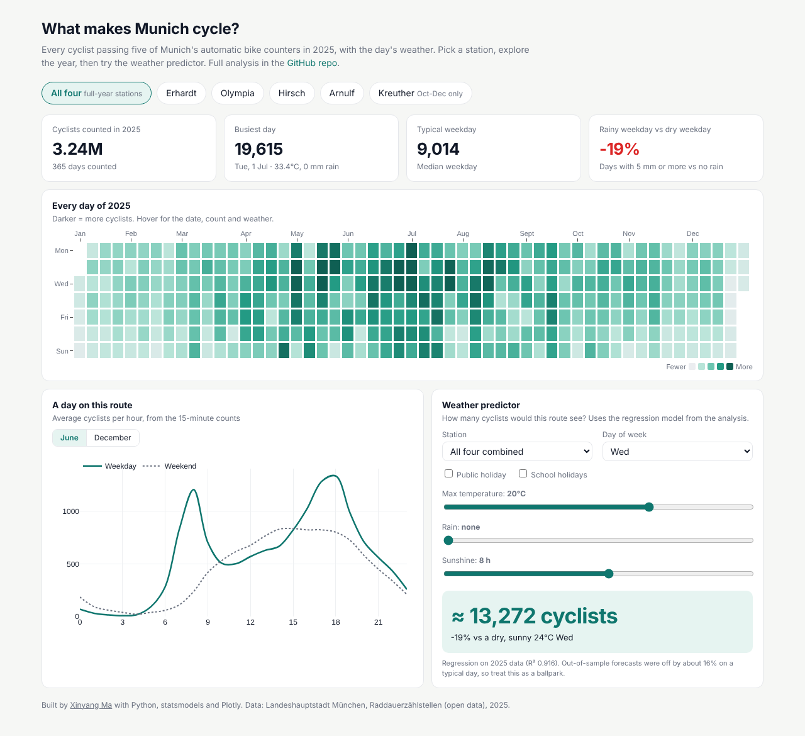
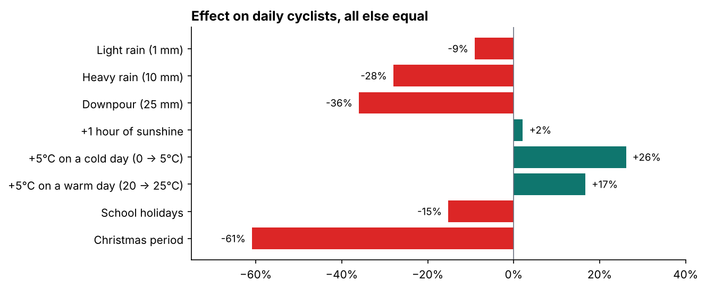
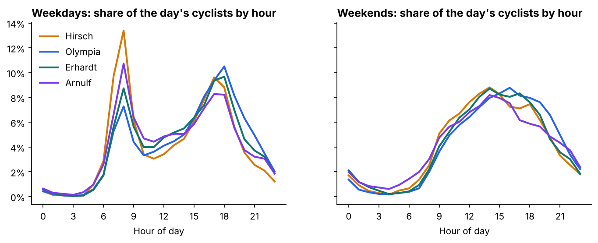
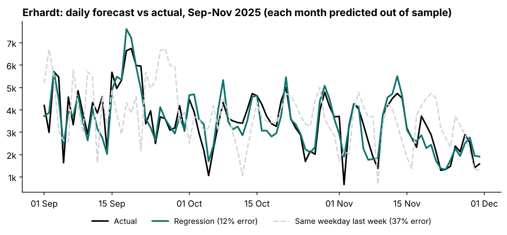

# What makes Munich cycle?

How weather, holidays and events drive cycling in Munich, using every count from the city's automatic bike counters in 2025.

**[Open the interactive dashboard](https://hakowxy.github.io/munich-cycling/)** · **[Read the full analysis](notebooks/analysis.ipynb)**

[](https://hakowxy.github.io/munich-cycling/)

The dashboard has a calendar of every day of 2025, hourly profiles per route, and a **weather predictor**: set the temperature, rain and day of the week, and it estimates how many cyclists a route will see.

## Key findings

**3.24 million cyclists** passed the four full-year counters in 2025. July was the busiest month, with **2.6 times as many cyclists as January**.

**Weather and calendar effects, all else equal** (regression on 1,455 station-days, R² = 0.92):

| Factor | Effect on daily cyclists |
|---|---|
| Light rain (1 mm) | −9% |
| Heavy rain (10 mm) | −28% |
| +5°C on a cold day (0 → 5°C) | +26% |
| +5°C on a warm day (20 → 25°C) | +17% |
| +1 hour of sunshine | +2% |
| School holidays | −15% |
| Christmas period | −61% |



- **Rain cost about 7% of the year's trips**, roughly 238,000 at these four counters.
- **Each route has a personality.** Hirsch and Kreuther are commuter routes: weekend traffic is half of weekday traffic, with sharp rush-hour peaks. Olympia and Erhardt stay at 80-85% on weekends, and their weekend peak shifts to the early afternoon.



- **The counters double as event sensors.** A 10 km city run tripled Olympia's count on 12 October. The ticketed *Sommernachtstraum* festival closed the park's paths on 19 July and cut the count to a fifth on a sunny 29°C Saturday.

## Forecast

Can tomorrow's volume be predicted from the calendar and the weather forecast? I tested this month by month, training only on earlier months (an expanding window, April to December):

| Model | Error (WAPE) |
|---|---|
| Same weekday last week (baseline) | 35.7% |
| XGBoost | 16.5% |
| **Regression** | **16.2%** |

Both models cut the baseline error by more than half. I chose the regression: it ties XGBoost overall, has a much better worst month (19% vs 29% in December), and every coefficient can be explained to a stakeholder.



## Data quality notes

- The data is clean. There are no gaps, the directions add up to the totals, and the 15-minute counts match the daily totals exactly.
- Weather is the same city-wide reading for every station.
- **Kreuther only reports from October 2025**, so it's left out of the models.
- **Arnulf records 94% of its traffic in one direction**, likely a one-way lane or a one-sided counter. That's why I compare stations by patterns rather than raw totals.

## What's in the repo

| Path | Contents |
|---|---|
| [`notebooks/analysis.ipynb`](notebooks/analysis.ipynb) | Full analysis: data checks, station profiles, weather model, events, forecast |
| [`docs/`](docs) | The dashboard (plain HTML + Plotly.js on GitHub Pages) |
| [`scripts/`](scripts) | Rebuild the notebook and the dashboard data |
| [`data/raw/`](data/raw) | Monthly daily-count files for 2025, plus 15-minute counts for June and December |

## Run it yourself

```bash
pip install -r requirements.txt
python scripts/build_notebook.py
jupyter nbconvert --to notebook --execute --inplace notebooks/analysis.ipynb
python scripts/build_dashboard_data.py
```

## Source

Landeshauptstadt München, *Raddauerzählstellen* ([opendata.muenchen.de](https://opendata.muenchen.de)). Public holidays come from the `holidays` package plus 15 August, and the school holidays are the 2025 Bavarian dates.

---

Made by [Xinyang Ma](https://github.com/hakowxy) · [LinkedIn](https://www.linkedin.com/in/xinyang-m-122844288/)
